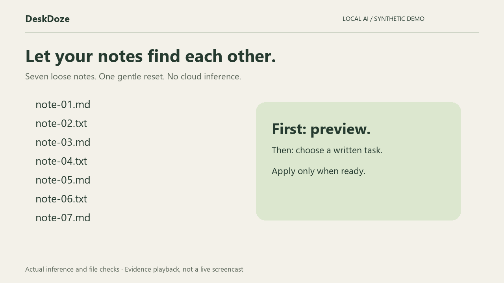

# DeskDoze

**Let your notes find each other.** A local AI tool that groups related text notes, quotes one small unfinished task per group, and tidies the files only after you review its plan.

[Watch the demo and inspect its report](https://qais-ui.github.io/deskdoze/) · [Read the DEV entry](https://dev.to/qais_ahmed_ce04207d1d815e/deskdoze-tidy-your-notes-leave-yourself-one-small-task-f59)



Built for the Hacktoberfest 2026 Week 3 **Slow and Steady** challenge. New project started October 21, 2026 (Asia/Amman). AI-assisted implementation with Codex.

## Try it

Requires Node.js 20 or newer. Run commands from this repository.

```sh
npm ci
npm run demo
```

Open `demo/report.html`. The demo creates seven synthetic notes in a new `work/demo-*/inbox` folder, runs the real model, applies six moves, then undoes them and verifies every original byte. It never targets your Documents or Downloads folder.

The first run downloads the quantized open model from Hugging Face into `.cache/`. After that:

```sh
npm run demo -- --offline
```

## Use your own notes

```sh
node src/cli.mjs plan "C:/path/to/notes" --out my-plan.json --offline
```

Open `my-plan.json.html` and review the exact source and destination paths in `my-plan.json`. Output files are created exclusively: use a different output filename for a later plan.

```sh
node src/cli.mjs apply my-plan.json --yes
node src/cli.mjs undo "C:/path/to/notes/.deskdoze-undo-PRINTED-ID.json"
```

Copy the actual journal path printed by `apply`. Never substitute a guessed ID. The journal remains after undo. Keep it until you are satisfied with the result. A process crash may leave `.deskdoze.lock`; remove that file only after confirming no DeskDoze process is running, then use the printed/stored journal to recover.

## How the open AI works

1. Read only top-level UTF-8 `.md` and `.txt` files, at most 100 files and 256 KiB each. Skip hidden files, links, directories and unsupported types.
2. Embed the first 900 characters of each note with **Xenova/all-MiniLM-L6-v2**, an ONNX conversion of the Sentence Transformers model, using **Transformers.js** and ONNX Runtime on CPU. The tokenizer may further truncate long excerpts.
3. Cluster by cosine similarity. Complete-link clustering requires every pair inside a merged group to exceed 0.48, preventing a chain of weak matches from joining unrelated work. Adjust with `--threshold 0.55` for stricter groups. Similarity is not a calibrated confidence probability.
4. Name a group from the most representative note's first nonblank line. Preserve the original filenames and contents. Isolated notes stay in place.
5. Extract unchecked Markdown tasks, `TODO:` and `NEXT:` lines. Quote the shortest by word count with its source filename and line number. This is a small written step, not an inferred priority or time estimate. No generative model invents a task.
6. Save a plan and a local HTML report. Only an explicit apply command moves anything.

The semantic model is essential: the synthetic filenames (`note-01.md`, etc.) carry no useful topic information, and every note has the same broad file type. An extension sorter cannot produce the garden, bicycle and soup groups. This is a demonstration, not a benchmark against every possible rules-based classifier.

## File safety and privacy

- SHA-256 checks detect content changes between planning and applying.
- Preflight rejects occupied destinations, traversal paths, duplicate sources and symbolic links/junctions.
- Exclusive copy, verification and source removal preserve bytes without overwriting a destination.
- A write-ahead journal lets undo recover a partially completed batch, including an interrupted move with both copies present.
- Undo checks the whole batch first and refuses to overwrite edited files.
- Directory removal uses empty-directory removal only. There is no recursive cleanup of user folders.
- An application lock prevents concurrent DeskDoze runs in the same folder. This is not protection against a separate program maliciously racing filesystem operations. Use a quiet local folder and retain backups for important data. Crash recovery is not a substitute for protection against disk failure.
- No content upload, telemetry, cloud inference, API key or subscription. Online mode permits model downloads; `--offline` requires an existing cache. Dependency installation and initial download require internet.
- Plans and HTML reports contain source excerpts and filenames. Review them before sharing; they are not encrypted.

## Verified demo

See `demo/verification.json` for the latest actual run, `demo/analysis.json` for its sanitized analysis, and `demo/report.html` for the visual result. The sample contains three related pairs and one unrelated note. Six moves were applied and undone with byte checks, and an unsupported file was left unchanged. Runtime depends on hardware and cache state. No user time-saving study has been performed.

```sh
npm test
npm audit
```

Tests cover byte preservation, repeated undo, stale inputs, occupied destinations, edited outputs, traversal, junctions, crash recovery, exact source extraction, weak semantic chains and HTML escaping. The demo separately exercises actual inference.

## Limits

English-focused model; no PDF, image, Office-document or nested-folder ingestion. Only the opening excerpt is embedded. Long notes or unrelated topics sharing vocabulary can be misgrouped. Explicit task syntax is required; no task is extracted from ordinary prose. Default threshold was chosen for this small demo and is not a validated universal setting. Review every plan.

## Attribution and license

- Project code: MIT, see `LICENSE`.
- [all-MiniLM-L6-v2 original model](https://huggingface.co/sentence-transformers/all-MiniLM-L6-v2): Apache-2.0.
- [Xenova ONNX conversion](https://huggingface.co/Xenova/all-MiniLM-L6-v2): Apache-2.0.
- [Transformers.js](https://github.com/huggingface/transformers.js): Apache-2.0.
- [ONNX Runtime](https://github.com/microsoft/onnxruntime): MIT.

Model weights are downloaded separately and not bundled in the repository. Synthetic demo notes and application code were created for this project. No competitor implementation was copied. No partner prize category is claimed.
